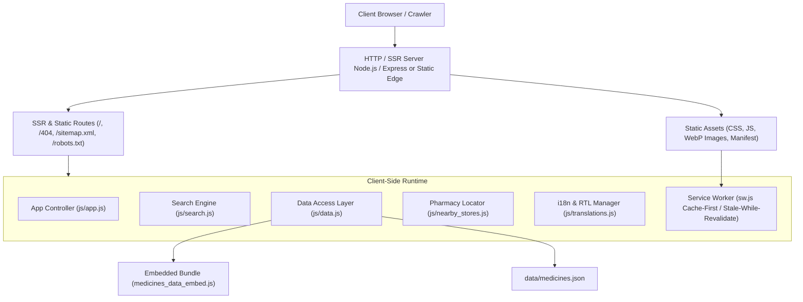

# Technical Architecture — Sasta Dawa Finder

## 1. High-Level System Overview

Sasta Dawa Finder is architected as an ultra-fast, hybrid web platform that combines server-side rendered (SSR) / pre-rendered static assets with a dynamic, progressive client-side engine. This dual-architecture guarantees that search engine bots (Googlebot, Bingbot) receive complete semantic HTML for indexing, while users enjoy single-page application (SPA) responsiveness, offline PWA capabilities, and sub-second page loads. Made by Maverick Tech Ventures.



---

## 2. Directory & Module Structure

```
/home/kali/medicine/
├── PRD.md                          # Product Requirements Document
├── ARCHITECTURE.md                 # System Architecture & Technical Specifications
├── RULES.md                        # Engineering Rules & Standards
├── DESIGN.md                       # Design System & UI/UX Guidelines
├── TASKS.md                        # Active Task Tracker & Checklist
├── MEMORY.md                       # Architectural Decisions & State Log
├── package.json                    # Node dependencies, scripts, metadata
├── package-lock.json
├── manifest.json                   # Web App Manifest (PWA)
├── sw.js                           # Offline Service Worker
├── robots.txt                      # Search engine crawler policies
├── sitemap.xml                     # XML Sitemap for search engines
├── 404.html                        # Standalone Custom 404 Error Page
├── index.html                      # Primary SSR / HTML entrypoint
├── css/
│   └── style.css                   # Core responsive design & design tokens
├── js/
│   ├── app.js                      # DOM Controller, event listeners, UI rendering
│   ├── data.js                     # In-memory database query & sorting operations
│   ├── search.js                   # Fuzzy prefix matching, tokenization, synonyms
│   ├── nearby_stores.js            # Geolocation, Haversine, map directions
│   ├── translations.js             # English/Urdu bilingual dictionaries & RTL helpers
│   └── medicines_data_embed.js     # Zero-latency embedded dataset fallback
├── data/
│   └── medicines.json              # Canonical DRAP medicine database
├── icons/
│   ├── icon.svg                    # Vector brand mark
│   ├── favicon.ico                 # Multi-resolution favicon
│   ├── icon-192.png                # PWA standard icon
│   └── icon-512.png                # PWA splash icon
├── scripts/
│   ├── sync_drug_data.js           # DRAP data validation & embed generator
│   ├── expand_database.js          # Ingestion script for new drug batches
│   └── generate_sitemap.js         # SEO sitemap builder
└── tests/
    ├── data.test.js                # Schema and data integrity tests
    ├── search.test.js              # Search, fuzzy matching, and edge case tests
    ├── alternatives_sort.test.js   # Generic grouping & sorting logic tests
    ├── nearby_stores.test.js       # Geolocation & directory tests
    ├── urdu_mode.test.js           # Bilingual & RTL DOM tests
    ├── ui_dom.test.js              # Core UI DOM integration tests
    ├── ui_responsive_branding.test.js # Breakpoints and brand guidelines tests
    ├── pwa.test.js                 # PWA manifest and service worker tests
    └── whatsapp_share.test.js      # Social sharing payload tests
```

---

## 3. Core Subsystems

### 3.1 Data Management & Ingestion Subsystem
- **Canonical Storage**: `data/medicines.json` holds structured pharmaceutical entries with schema validation (`id`, `name`, `brand`, `generic_name`, `salt_group_id`, `category`, `dosage_form`, `strength`, `pack_size`, `pack_price`, `unit_price`, `manufacturer`).
- **Zero-Latency Inlining**: `js/medicines_data_embed.js` exposes `window.__EMBEDDED_MEDICINES__`. When the app is accessed over `file://` or restricted environments where asynchronous `fetch` is prohibited by CORS policies, the app falls back seamlessly to embedded memory data.
- **Sync & Validation Pipeline**: `scripts/sync_drug_data.js` validates data integrity, verifies positive pricing, deduplicates slugs, and compiles the embed bundle.

### 3.2 Search & Matching Engine
- **Prefix & Token Matching**: In `js/search.js`, queries are normalized (lowercase, special characters stripped, trimmed). Matching evaluates exact brand match, prefix brand match, generic formula match, and category membership.
- **Synonym Dictionary**: Handles clinical synonyms and brand aliases (e.g., Metamizole ↔ Novaminsulfon, Rivotril ↔ Clonazepam).
- **Ranking Function**:
  1. Exact Brand match (`score = 100`)
  2. Prefix Brand match (`score = 80`)
  3. Brand substring match (`score = 60`)
  4. Exact Generic salt match (`score = 50`)
  5. Generic salt substring match (`score = 40`)

### 3.3 Server-Side Rendering (SSR) & Technical SEO Architecture
- **HTML Prerendering**: Pre-renders semantic HTML containing critical meta tags, canonical link, Open Graph / Twitter Cards, breadcrumb navigation, and structured JSON-LD schemas (`FAQPage`, `MedicalWebPage`, `BreadcrumbList`).
- **Crawler Optimization**: Googlebot and other crawlers receive immediate 200 HTTP responses with fully rendered `<main>`, `<h1>`, `<header>`, and `<footer>` elements before JavaScript execution.
- **Error Response Protocol**: Missing routes return an explicit HTTP 404 response serving `404.html` with `<meta name="robots" content="noindex, follow">` preventing soft-404 penalization.

### 3.4 Responsive UI & Layout Architecture
- **Fluid Layout**: CSS Grid and Flexbox layouts structured to eliminate any horizontal overflow on viewports down to 320px.
- **Visual Stability (Zero CLS)**: Explicit dimensions (`width`, `height`, `aspect-ratio`) set on all image, SVG, and icon containers. Skeletons and pre-allocated card boxes avoid reflow during search result rendering.
- **Bilingual Layout Switching**: Toggling Urdu applies `dir="rtl"` to `document.documentElement` and swaps CSS rules via logical properties (`margin-inline-start`, `padding-inline-end`).

### 3.5 Progressive Web App (PWA) & Offline Caching
- **Service Worker (`sw.js`)**:
  - Pre-caches core application shell (`index.html`, `css/style.css`, `js/app.js`, `manifest.json`, `icons/icon.svg`).
  - Network-first strategy for data queries with cache fallback.
  - Cache-first strategy for static assets and icons.
